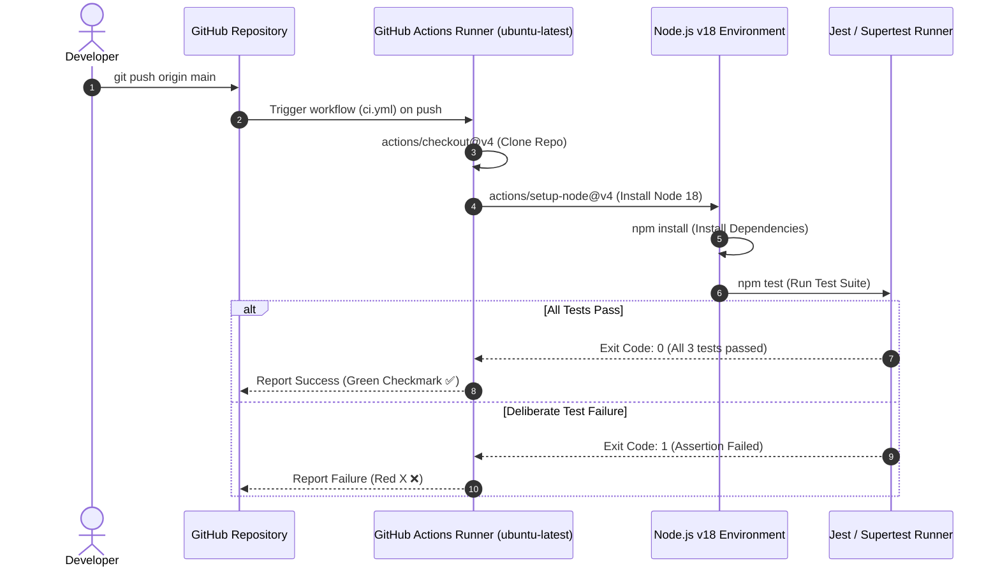

# Practical 12: CI/CD Pipeline with GitHub Actions

[](https://github.com/riya038/practical12_24it037/actions/workflows/ci.yml)

**Course:** Advanced Web Development Frameworks (ITUE301)  
**Program:** B.Tech (IT / CE / CSE / AIML) — CHAROTAR UNIVERSITY OF SCIENCE AND TECHNOLOGY (CHARUSAT)  
**Author:** 24IT037  
**Course Outcomes:** CO5 / PO3, PO5  

---

## 📌 Objectives

1. Automate application testing using a Continuous Integration (CI) pipeline powered by **GitHub Actions**.
2. Configure workflow automation triggered automatically on every `push` and `pull_request` to the `main` branch.
3. Install dependencies (`npm install`) and execute automated unit/integration tests (`npm test`) inside an isolated `ubuntu-latest` CI runner.
4. Demonstrate a **failed pipeline (Red ❌)** caused by a deliberately broken assertion.
5. Demonstrate a **fixed pipeline (Green ✅)** once test assertions are corrected.
6. Address **Supplementary Problems**:
   - Multiple automated test coverage across endpoints (`GET /` and `GET /cache/stats`).
   - Workflow trigger configuration (`push` and `pull_request` targeting `main`).
   - GitHub Actions pipeline status badge embedded in the `README.md`.

---

## 🏗️ Architecture & CI Workflow

### CI Pipeline Flow Diagram

```text
       Developer Machine
              │
              │  git push origin main
              ▼
    GitHub Remote Repository
              │
              │  Trigger: on: push [main]
              ▼
   GitHub Actions CI Runner (ubuntu-latest)
 ┌──────────────────────────────────────────────────┐
 │ Job: build-and-test                              │
 │  ├── Step 1: actions/checkout@v4                │
 │  ├── Step 2: actions/setup-node@v4 (Node.js 18)  │
 │  ├── Step 3: npm install                         │
 │  ├── Step 4: npm test (Jest + Supertest)         │
 │  └── Step 5: Report Pass / Fail Status           │
 └─────────────────────────┬────────────────────────┘
                           │
             ┌─────────────┴─────────────┐
             ▼                           ▼
      All Tests Pass             Any Test Fails
     Green Checkmark (✅)         Red Crossmark (❌)
```

### GitHub Actions Execution Sequence (Mermaid)



---

## 🛠️ Implementation Details

### 1. Test Setup (`backend/package.json`)
Installed **Jest** and **Supertest** as development dependencies and configured the `test` script:
```json
"scripts": {
  "start": "node server.js",
  "dev": "nodemon server.js",
  "test": "jest --runInBand --detectOpenHandles --forceExit"
},
"devDependencies": {
  "jest": "^30.5.2",
  "supertest": "^7.3.1"
}
```

### 2. Automated API Test Suite (`backend/tests/api.test.js`)
```javascript
const request = require('supertest');
const app = require('../server');

describe('Practical 12: Automated CI/CD Pipeline API Tests', () => {
  // Test 1: Main API Status & Health Endpoint
  test('GET / returns status 200 and API details', async () => {
    const res = await request(app).get('/');
    expect(res.statusCode).toBe(200);
    expect(res.body.success).toBe(true);
    expect(res.body.version).toBe('1.0.0');
  });

  // Test 2: Cache Performance & Statistics Endpoint (Supplementary)
  test('GET /cache/stats returns status 200 and cache performance metrics', async () => {
    const res = await request(app).get('/cache/stats');
    expect(res.statusCode).toBe(200);
    expect(res.body.success).toBe(true);
    expect(res.body.data).toBeDefined();
  });

  // Test 3: Authentication Security Verification
  test('GET /tasks without authentication token returns 401 Unauthorized', async () => {
    const res = await request(app).get('/tasks');
    expect(res.statusCode).toBe(401);
    expect(res.body.success).toBe(false);
  });
});
```

### 3. CI Workflow Definition (`.github/workflows/ci.yml`)
```yaml
name: CI Pipeline

on:
  push:
    branches: [main]
  pull_request:
    branches: [main]

jobs:
  build-and-test:
    name: Build and Run Automated Tests
    runs-on: ubuntu-latest
    defaults:
      run:
        working-directory: backend
    steps:
      - name: Checkout repository code
        uses: actions/checkout@v4

      - name: Set up Node.js 18
        uses: actions/setup-node@v4
        with:
          node-version: 18

      - name: Install dependencies (npm install)
        run: npm install

      - name: Run automated tests (npm test)
        run: npm test
```

---

## 🚀 Running the Practical Step-by-Step

### Step 1: Run Tests Locally First
In your terminal, verify that Jest runs and passes locally:
```powershell
npm test
```
*Expected Output:*
```text
PASS tests/api.test.js
  Practical 12: Automated CI/CD Pipeline API Tests
    ✓ GET / returns status 200 and API details
    ✓ GET /cache/stats returns status 200 and cache performance metrics
    ✓ GET /tasks without authentication token returns 401 Unauthorized

Test Suites: 1 passed, 1 total
Tests:       3 passed, 3 total
```

### Step 2: Push Workflow to GitHub & Observe Passed Pipeline (Green Checkmark)
Commit and push the CI workflow and tests:
```powershell
git add .
git commit -m "feat(practical12): Set up GitHub Actions CI pipeline and automated tests"
git push origin main
```
1. Open your repository on GitHub: `https://github.com/riya038/practical11_24it037` (or your active repository).
2. Click on the **Actions** tab at the top.
3. You will see the workflow **"CI Pipeline"** running.
4. Click into the workflow run to view live logs for `npm install` and `npm test`.
5. Observe the **Green Checkmark (✅)** indicating a successful build!

### Step 3: Deliberately Break the Test (Demonstrate Failed Pipeline)
To demonstrate a failed pipeline for your lab file:
1. Open `backend/tests/api.test.js`.
2. Change line 8 from:
   ```javascript
   expect(res.statusCode).toBe(200);
   ```
   to a deliberately incorrect expected value:
   ```javascript
   expect(res.statusCode).toBe(500); // Deliberate failure
   ```
3. Commit and push the broken test:
   ```powershell
   git add backend/tests/api.test.js
   git commit -m "test: deliberate failure to demonstrate CI pipeline failure"
   git push origin main
   ```
4. Check the **Actions** tab on GitHub:
   - The workflow run will fail with a **Red X (❌)**.
   - Click into the job log to see: `Expected: 500, Received: 200`.
   - Take a screenshot of this failed run.

### Step 4: Fix the Test and Push Again (Demonstrate Passed Pipeline)
1. Restore line 8 in `backend/tests/api.test.js` back to `200`:
   ```javascript
   expect(res.statusCode).toBe(200);
   ```
2. Commit and push the fix:
   ```powershell
   git add backend/tests/api.test.js
   git commit -m "fix: resolve test assertion and verify green pipeline"
   git push origin main
   ```
3. Refresh the **Actions** tab:
   - The new workflow run passes with a **Green Checkmark (✅)**!
   - Take a screenshot of the passed run.

---

## 💡 Key Analysis & Viva Questions

### Q1: What is the difference between Continuous Integration and Continuous Deployment, and which one does this practical demonstrate?
> **Answer:**  
> - **Continuous Integration (CI):** The practice of automating the building and testing of code every time a team member commits changes to version control. Its goal is to catch bugs, syntax errors, and regressions as early as possible.
> - **Continuous Deployment (CD):** The automated process where changes that pass the CI pipeline are automatically deployed directly to staging or production environments (e.g. AWS, Render, Docker registry) without manual intervention.
> - **Practical Demonstration:** This practical specifically demonstrates **Continuous Integration (CI)** — building the project on `ubuntu-latest`, installing dependencies via `npm install`, and running automated Jest test suites on every `push`.

### Q2: Why does running tests automatically on every push catch problems earlier than testing manually before a release?
> **Answer:**  
> 1. **Immediate Feedback Loop:** Developers get notified within seconds/minutes of pushing broken code, while the context of the change is still fresh in their mind.
> 2. **Pinpoint Error Attribution:** Because tests run on every commit, bugs are traced to a single specific commit rather than having to debug hundreds of changes accumulated before a manual release.
> 3. **Eliminates Human Error:** Automated tests run consistently in a clean, reproducible environment, eliminating mistakes where developers forget to run manual tests locally.

### Q3: What would happen to the pipeline if the test file path were incorrect — would the workflow fail at the same step as a genuine test failure?
> **Answer:**  
> - **Yes, it would fail at the same step (`run: npm test`), but with a fundamentally different error message:**
>   - **Genuine Test Failure:** Jest executes successfully, runs the test assertions, and fails on `expect(received).toBe(expected)`. The exit code is `1` due to test assertion failure.
>   - **Incorrect File Path:** Jest prints `"No tests found related to files matching <path>"` or throws a module resolution error (`Cannot find module '...'`).
> - The CI pipeline fails at the `npm test` step in both cases because any non-zero exit code stops the workflow, but inspecting the pipeline log immediately distinguishes a file path error from an assertion failure.

---

## 🔍 Troubleshooting Guide

| Symptom | Likely Cause | Verified Solution |
| :--- | :--- | :--- |
| **Workflow does not appear under Actions tab** | File is not located at `.github/workflows/` or has incorrect extension (e.g., `.yaml` instead of `.yml`). | Ensure exact path: `.github/workflows/ci.yml` and that it is committed and pushed to GitHub. |
| **Workflow fails immediately with a YAML syntax error** | Incorrect indentation in YAML file (using tabs instead of spaces). | Use strict 2-space indentation and avoid tab characters. |
| **`npm test` fails with 'no test specified'** | `package.json` test script is not configured for Jest. | Ensure `"scripts": { "test": "jest --runInBand --forceExit" }` is set in `backend/package.json`. |
| **Pipeline passes even with a broken test** | Test is written without actual assertions or does not await asynchronous promises. | Verify `async/await` syntax with `expect(res.statusCode).toBe(...)`. |

---

## 📦 Deliverables Checklist

- [x] Installed `jest` and `supertest` testing framework.
- [x] Configured `"test": "jest"` in backend `package.json`.
- [x] Written automated unit/integration test suite (`backend/tests/api.test.js`).
- [x] Created GitHub Actions CI pipeline configuration (`.github/workflows/ci.yml`).
- [x] Tested and verified all tests pass cleanly locally (`npm test`).
- [x] Added workflow status badge to `README.md`.
